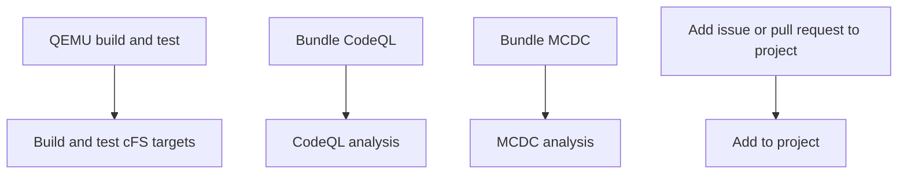

# cFS GitHub Actions workflows

The cFS bundle defines workflows for its own repository and reusable workflows for
cFS components. A workflow that declares `workflow_call` can be called from a job
in another workflow. See each linked file for its inputs, defaults, and triggers.

## Reusable workflows

| Workflow | Purpose |
| --- | --- |
| [Add to project](./add-to-project-reusable.yml) | Routes issues and pull requests to GitHub Projects. |
| [Build and test cFS targets](./build-cfs-multitarget.yml) | Builds configured cFS targets, publishes build artifacts, and runs local tests when enabled. |
| [Build documentation](./build-doc-reusable.yml) | Builds component documentation and archives the PDF and build logs. |
| [Build and run an app](./build-run-app-reusable.yml) | Builds a cFS app in the bundle and checks that it starts. |
| [CodeQL analysis](./codeql-reusable.yml) | Runs CodeQL on the configured cFS bundle or component. |
| [Format check](./format-check.yml) | Runs clang-format and, for pull requests, checks commit messages and issue references. |
| [MCDC analysis](./mcdc-reusable.yml) | Builds and runs tests to measure modified condition/decision coverage. |
| [Static analysis](./static-analysis-reusable.yml) | Runs Cppcheck on the configured source. |
| [Unit tests and coverage](./unit-test-coverage-reusable.yml) | Runs component unit tests and checks configured coverage thresholds. |

## Calls from the cFS bundle

The arrows show the reusable workflow called by each bundle workflow. Component
repositories define their own callers.

## Workflows run by the bundle

| Workflow | Purpose |
| --- | --- |
| [QEMU build and test](./test-cfs-qemu.yml) | Builds documentation and cFS targets, then runs configured builds in containers. |
| [Bundle CodeQL](./codeql-analysis.yml) | Runs the reusable CodeQL workflow on manual dispatch. |
| [Bundle MCDC](./mcdc.yml) | Runs the reusable MCDC workflow. |
| [Add issue or pull request to project](./add-to-project.yml) | Calls the reusable project workflow on configured issue and pull request events. |
| [Format check](./format-check.yml) | Runs directly for configured pull requests and manual dispatch, and can also be reused. |
| [Build COSMOS gem](./cosmos-gem.yml) | Packages the cFS COSMOS plugin. |
| [Changelog](./changelog.yml) | Generates a changelog on manual dispatch. |
| [Update wiki](./cfs-wiki.yml) | Generates and archives configuration control board agenda material. |
| [Update cFS bundle](./update-bundle.yml) | Checks for submodule updates on a schedule or on manual dispatch. |
